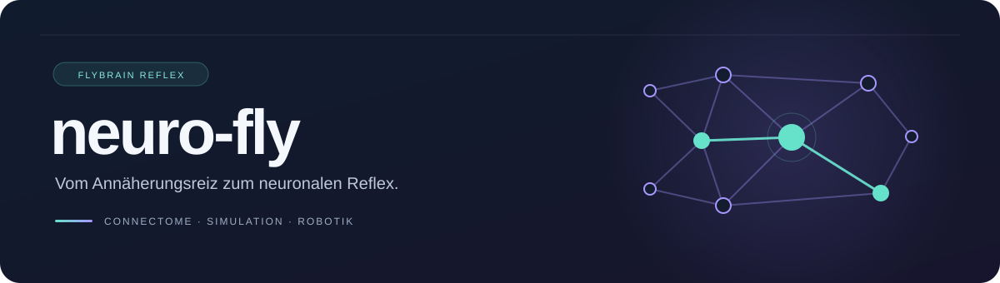

<div align="center">



# neuro-fly

**Ein Fluchtreflex aus dem Fliegenkonnektom. Ein Sensor. Eine einfache Ausgabe.**

Ein Forschungsprototyp für neuronale Robotik auf dem Raspberry Pi 3B+.


[Schnellstart](#schnellstart) · [Ergebnisse](#bisherige-ergebnisse) · [Projektstand](STATUS.md) · [Mitmachen](CONTRIBUTING.md)

</div>

---

## Die Idee

Eine Fruchtfliege reagiert auf eine herannahende Gefahr mit einem schnellen
Fluchtreflex. **FlyBrain Reflex** untersucht, wie sich ein Ausschnitt ihres
neuronalen Schaltkreises für einen kleinen Demonstrator nutzen lässt: Ein Sensor
erkennt Annäherung, ein Spiking Neural Network verarbeitet den Reiz und seine
motorische Ausgabe soll eine sichtbare Reaktion auslösen, zunächst vermutlich
über eine LED oder einen anderen einfachen physischen Ausgang.

> [!IMPORTANT]
> **Aktuell: Software-Demonstrator ohne Hardware.** Der separate
> NeuroHex-Referenzkern wurde mit echten Connectome-Daten geprüft; ein eigener
> Mock-Sensor- und Mock-Ausgangspfad ist implementiert. Eine Kamera
> und ein Servo sind nicht mehr eingeplant. Als Sensor kommen ein laserbasierter
> ToF-Abstandssensor oder Ultraschall infrage; als einfacher Ausgang eine LED
> oder eine andere geeignete Lösung. Bauteile und Pi-Erprobung stehen noch aus.

## Vom Reiz zur sichtbaren Reaktion


Der physische Ausgang soll durch die **SNN-Ausgabe** ausgelöst werden, nicht
direkt durch einen Distanzschwellwert. Die Sensorwahl ist offen: möglich sind
ein laserbasierter ToF-Sensor (z. B. VL53L4CD oder VL53L0X) oder ein
Ultraschallsensor (z. B. HC-SR04). Ein Abstandssignal als `visual_input` ist
eine technische Annäherungsabbildung, keine Simulation eines vollständigen
Fliegenauges. Ob eine LED die schulische Aktoranforderung erfüllt, ist noch zu
klären.

## Was bereits funktioniert

| Baustein | Stand |
| :--- | :--- |
| Öffentliche MaleCNS-Daten über Virtual Fly Brain abrufen | Geprüft in der Cloud |
| Matrix, Verbindungsliste und neuronale Gruppen prüfen | 992 Neuronen · 1.308 gerichtete Verbindungen |
| NeuroHex-Referenzkern mit synthetischem Annäherungsreiz ausführen | Reflexprüfung bestanden |
| Unter begrenztem CPU-Zeitbudget messen | 9 Läufe · 315 Simulationsschritte dokumentiert |
| Mock-Sensor → echtes SNN → Mock-Ausgang | Unter WSL mit echten Connectome-Daten geprüft |
| Pi 3B+, Abstandssensor und einfacher physischer Ausgang integrieren | Noch offen |

## Schnellstart

**Getestet:** Linux x86_64, Python 3.12, GCC/G++. Erforderlich sind außerdem
Git, Python-`venv` und Internetzugriff auf GitHub, PyPI und Virtual Fly Brain.
Die Paketkombination ist noch nicht auf ARM validiert.

```bash
git clone https://github.com/dj-nic/neuro-fly.git
cd neuro-fly
bash scripts/setup.sh
```

Das Setup legt die NeuroHex-Referenz als **separaten Nachbarordner** an,
installiert die festgehaltenen Python-Paketversionen in `.venv`, beschafft
fehlende Connectome-Dateien und führt die Daten- und Reflexprüfung aus.

```text
projekte/
├── neuro-fly/              # Eigene Dokumentation und Prüfwerkzeuge
└── neurohex-reference/     # Separater, festgehaltener Upstream-Stand
```

**Erwartete Prüfung:** 35 Schritte à 20 ms, ruhige SNN-Ausgabe ohne Reiz
und ein Fluchtwert über 0,5 bei starkem Annäherungsreiz. Dummy-Daten werden
abgelehnt. Der JSON-Bericht liegt unter `artifacts/benchmark.json`.

<details>
<summary><strong>Vorhandenes Setup erneut prüfen</strong></summary>

```bash
export CC=gcc CXX=g++ OMP_NUM_THREADS=1 OPENBLAS_NUM_THREADS=1
export MPLBACKEND=Agg MPLCONFIGDIR="$PWD/artifacts/matplotlib"
.venv/bin/python scripts/validate_brain.py \
  --reference ../neurohex-reference \
  --output artifacts/benchmark.json
```

`REFERENCE_DIR` und `VENV_DIR` können für `scripts/setup.sh` angepasst werden.
Vorhandene Referenz-Checkouts mit einem abweichenden Commit werden nicht
zurückgesetzt. Python nicht mit `-O` ausführen: Die Prüfungen nutzen Assertions.
Ein fehlgeschlagener Check liefert einen Exitcode ungleich null.

</details>

## Software-Demonstration ohne Hardware

Die schnellen Tests laufen mit Python auf Windows oder Linux im
Projektverzeichnis; Brian2 und GPIO sind nicht nötig. Die Strukturtests für
Connectome-Daten nutzen NumPy und werden übersprungen, falls es nicht
installiert ist:

```bash
python -m unittest discover -s tests/unit -v
```

Für den vollständigen Mock-Pfad mit dem **echten** NeuroHex-Kern unter
Linux/WSL zunächst das Setup oben ausführen. Zum erstmaligen Anlegen der
Umgebung benötigt Ubuntu das zur Python-Version passende `python3-venv`-Paket
mit `ensurepip`; eine vorhandene Umgebung mit Pip wird wiederverwendet.
Danach:

```bash
export CC=gcc CXX=g++ MPLBACKEND=Agg MPLCONFIGDIR="$PWD/artifacts/matplotlib"
export OMP_NUM_THREADS=1 OPENBLAS_NUM_THREADS=1 MKL_NUM_THREADS=1 NUMEXPR_NUM_THREADS=1
.venv/bin/python -m neuro_fly demo --scenario approach \
  --reference ../neurohex-reference --report artifacts/mock-demo.json
.venv/bin/python -m unittest discover -s tests/integration -v
```

Der Referenzpfad ist optional und zeigt standardmäßig auf den Nachbarordner.
Weitere reproduzierbare Szenarien sind `still`, `receding`, `jitter`,
`invalid` und `far`. Ohne den gepinnten Checkout und strukturell validierte
Connectome-Dateien bricht die Demo mit Fehler ab; sie ersetzt das SNN nicht
durch ein Dummy-Netz. Ein Integrationslauf bestand unter WSL/x86_64; ein auf
einer anderen Umgebung übersprungener Test ist kein eigener Nachweis.

Der Abstand wird über relative Annäherungsgeschwindigkeit `v/d` auf
`looming_strength` abgebildet. Medianfilter und Glättung mindern Jitter;
ungültige oder veraltete Messungen setzen die Eingabe zurück und schalten den
Ausgang ab. Die voreingestellten Filter- und Skalierungswerte sind technische
Demo-Annahmen und müssen mit dem ausgewählten Sensor kalibriert werden:
Medianfenster 3, EMA α=0,35, Nenner mindestens 50 mm, Vollaussteuerung bei
1 s⁻¹ und maximal 0,5 s Abstand zwischen gültigen Messungen.

Die Schutzlogik löst ausschließlich aus `escape_magnitude > 0,5` einen
250-ms-Impuls aus. Ein weiterer Impuls erfordert einen Rückgang unter 0,3 und
1 s Cooldown. Der Timer läuft unabhängig vom nächsten Brain-Step; seine
tatsächliche Genauigkeit ist betriebssystemabhängig. Der Bericht enthält
synthetische Sensorzeit und getrennte Wandzeiten, keine physische
End-to-End-Latenz.

Die Python-Schnittstellen sind in `neuro_fly` verfügbar: Ein `DistanceSensor`
liefert `DistanceSample(distance_mm, timestamp_s, valid)`; `ApproachEncoder`
erzeugt daraus den Reiz. `NeuroHexBrainAdapter.step()` liefert den Fluchtwert,
und `Output.set_active(bool)` ist die spätere Schnittstelle für eine LED oder
einen anderen Ausgang. `Pipeline` verbindet diese Bausteine. Zeitstempel der
Mock-Messreihe sind synthetisch; Impulse und Laufzeiten verwenden die monotone
Wanduhr.

## Bisherige Ergebnisse

Messreihe vom **26.10.2026**, Cloud-x86_64, jeweils ein Kern und drei Wiederholungen:

| CPU-Zeitbudget | Ø Rechenzeit je 20-ms-Step | Testreiz → Fluchtschwelle |
| :--- | ---: | ---: |
| Ohne zusätzliches Limit | 69,5 ms | 0,51–0,80 s |
| 35 % eines Kerns | 310,3 ms | 2,63–3,60 s |
| 22,24 % eines Kerns | 554,5 ms | 4,51–5,15 s |

> [!NOTE]
> **Diese Werte sind keine Pi-3B+-Messwerte.** Die Cloud-CPU ließ sich nicht
> stabil auf die dokumentierte Pi-Referenz kalibrieren. Die Reflexfunktion
> bestand alle neun Läufe; der 20-ms-Echtzeittakt wurde nicht erreicht.
> Sensor- und Ausgangslatenz sind in den Messungen nicht enthalten.

[Quellen und Messmethode →](docs/PI_3B_PROXY.md) · [Maschinenlesbare Ergebnisse →](results/cloud-pi-budget-2026-10-26.json)

## Roadmap

- [x] **Grundlage:** Referenzkern untersuchen, echte Daten abrufen und Reflex prüfen.
- [x] **Messbarkeit:** Datenvalidierung und CPU-Budget-Experimente dokumentieren.
- [x] **Software-Grundlage:** Mock-Sensor, Brainadapter, Mock-Ausgang und Schutzlogik implementieren.
- [x] **Echte SNN-Kopplung:** Mock-Pfad mit gepinntem Kern und echten Daten unter WSL prüfen.
- [ ] **Pi-Baseline:** ARM-Kompatibilität, Laufzeiten, RAM und Langzeitverhalten messen.
- [ ] **Hardware:** Sensor → SNN → einfachen physischen Ausgang koppeln und Reaktionszeiten prüfen.

Die ausführliche Aufgabenliste und die bekannten Grenzen stehen in [STATUS.md](STATUS.md).

## Dokumentation

| Einstieg | Inhalt |
| :--- | :--- |
| [Projektstand](STATUS.md) | Was belegt ist und was als Nächstes ansteht |
| [Projektplanung (Word)](docs/Projektplan_Fruchtfliegengehirn_Raspberry_Pi.docx) | Projektidee und aktuelle Hardwareplanung |
| [Umsetzungsplan](docs/UMSETZUNG.md) | Ursprüngliche Anleitung; aktuelle Hardwareplanung siehe Projektstand |
| [Pi-Referenzen und Cloud-Messung](docs/PI_3B_PROXY.md) | Quellen, Methode und Grenzen der Drosselung |
| [Mitwirken](CONTRIBUTING.md) | Entwicklungsablauf und Anforderungen an Änderungen |

<details>
<summary><strong>Repository-Struktur</strong></summary>

```text
neuro-fly/
├── .github/                    # Issue- und Pull-Request-Vorlagen
├── docs/                       # Planung, Messbericht und Grafiken
├── results/                    # Archivierte JSON-Messreihe
├── neuro_fly/                  # Sensor, Brainadapter, Schutzlogik und Demo
├── tests/                      # Schnelle Unit- und separate Integrationstests
├── scripts/
│   ├── setup.sh                # Referenz und Python-Umgebung vorbereiten
│   ├── validate_brain.py       # Echte Daten und Reflexverhalten prüfen
│   └── cpu_limit.py            # Linux-Prozessgruppe zeitlich drosseln
├── requirements-dev.lock       # Getestete Python-Paketversionen
├── CONTRIBUTING.md
└── STATUS.md
```

Generierte Daten, Caches und virtuelle Umgebungen bleiben lokal und werden
nicht versioniert.

</details>

## Referenz und Lizenzstand

Der neuronale Referenzkern stammt aus
[Project NeuroHex](https://github.com/shakeabhishek/project-neurohex), festgehalten
auf Commit [`5d1052b`](https://github.com/shakeabhishek/project-neurohex/tree/5d1052b995db12fa1baf8d42f6a94c3f0695817d).
Die Daten beschreiben die direkte Giant-Fiber-Nachbarschaft aus **MaleCNS**,
abrufbar über [Virtual Fly Brain](https://www.virtualflybrain.org/).
Die Simulation verwendet [Brian2](https://briansimulator.org/).

NeuroHex bleibt ein separater Checkout; sein Anwendungscode ist hier nicht
übernommen. Upstream nennt MIT, enthielt im geprüften Stand aber keine
eigenständige LICENSE-Datei. Lizenztext und Attribution sind vor einer
Codeübernahme zu klären. Auch für dieses Repository wurde bislang keine
eigene Open-Source-Lizenz festgelegt.
