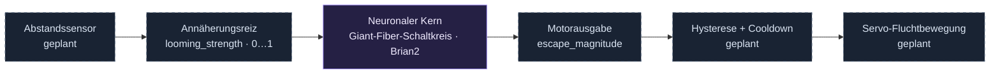

<div align="center">


# neuro-fly

**Ein Fluchtreflex aus dem Fliegenkonnektom. Ein Sensor. Ein Servo.**

Ein Forschungsprototyp für neuronale Robotik auf dem Raspberry Pi 3B+.


[Schnellstart](#schnellstart) · [Ergebnisse](#bisherige-ergebnisse) · [Projektstand](STATUS.md) · [Mitmachen](CONTRIBUTING.md)

</div>

---

## Die Idee

Eine Fruchtfliege reagiert auf eine herannahende Gefahr mit einem schnellen
Fluchtreflex. **FlyBrain Reflex** untersucht, wie sich ein Ausschnitt ihres
neuronalen Schaltkreises für einen kleinen Roboter nutzen lässt: Ein Sensor
erkennt Annäherung, ein Spiking Neural Network verarbeitet den Reiz und seine
motorische Ausgabe soll eine kurze Servobewegung auslösen.

> [!IMPORTANT]
> **Aktuell: Simulation und Vorbereitung ohne Hardware.** Der separate
> NeuroHex-Referenzkern wurde mit echten Connectome-Daten geprüft. Eigene
> Sensor- und Servo-Adapter sowie die Erprobung auf dem Pi 3B+ stehen noch aus.

## Vom Reiz zur Bewegung



Der Aktor soll durch die **SNN-Ausgabe** ausgelöst werden. Der bevorzugte
Sensoreinstieg ist ein VL53L0X. Sein Abstandssignal als `visual_input` ist eine
technische Annäherung, keine Simulation eines vollständigen Fliegenauges.

## Was bereits funktioniert

| Baustein | Stand |
| :--- | :--- |
| Öffentliche MaleCNS-Daten über Virtual Fly Brain abrufen | Geprüft in der Cloud |
| Matrix, Verbindungsliste und neuronale Gruppen prüfen | 992 Neuronen · 1.308 gerichtete Verbindungen |
| NeuroHex-Referenzkern mit synthetischem Annäherungsreiz ausführen | Reflexprüfung bestanden |
| Unter begrenztem CPU-Zeitbudget messen | 9 Läufe · 315 Simulationsschritte dokumentiert |
| Pi 3B+, Sensor und Servo integrieren | Noch offen |

## Schnellstart

**Getestet:** Linux x86_64, Python 3.12, GCC/G++. Erforderlich sind außerdem
Git, Python-`venv` und Internetzugriff auf GitHub, PyPI und Virtual Fly Brain.
Die Paketkombination ist noch nicht auf ARM validiert.

```bash
git clone https://github.com/dj-nic/neuro-fly.git
cd neuro-fly
bash scripts/setup.sh
```

Das Setup legt die NeuroHex-Referenz als **separaten Nachbarordner** an,
installiert die festgehaltenen Python-Paketversionen in `.venv`, beschafft
fehlende Connectome-Dateien und führt die Daten- und Reflexprüfung aus.

```text
projekte/
├── neuro-fly/              # Eigene Dokumentation und Prüfwerkzeuge
└── neurohex-reference/     # Separater, festgehaltener Upstream-Stand
```

**Erwartete Prüfung:** 35 Schritte à 20 ms, ruhige Motorausgabe ohne Reiz
und ein Fluchtwert über 0,5 bei starkem Annäherungsreiz. Dummy-Daten werden
abgelehnt. Der JSON-Bericht liegt unter `artifacts/benchmark.json`.

<details>
<summary><strong>Vorhandenes Setup erneut prüfen</strong></summary>

```bash
export CC=gcc CXX=g++ OMP_NUM_THREADS=1 OPENBLAS_NUM_THREADS=1
export MPLBACKEND=Agg MPLCONFIGDIR="$PWD/artifacts/matplotlib"
.venv/bin/python scripts/validate_brain.py \
  --reference ../neurohex-reference \
  --output artifacts/benchmark.json
```

`REFERENCE_DIR` und `VENV_DIR` können für `scripts/setup.sh` angepasst werden.
Vorhandene Referenz-Checkouts mit einem abweichenden Commit werden nicht
zurückgesetzt. Python nicht mit `-O` ausführen: Die Prüfungen nutzen Assertions.
Ein fehlgeschlagener Check liefert einen Exitcode ungleich null.

</details>

## Bisherige Ergebnisse

Messreihe vom **26.10.2026**, Cloud-x86_64, jeweils ein Kern und drei Wiederholungen:

| CPU-Zeitbudget | Ø Rechenzeit je 20-ms-Step | Testreiz → Fluchtschwelle |
| :--- | ---: | ---: |
| Ohne zusätzliches Limit | 69,5 ms | 0,51–0,80 s |
| 35 % eines Kerns | 310,3 ms | 2,63–3,60 s |
| 22,24 % eines Kerns | 554,5 ms | 4,51–5,15 s |

> [!NOTE]
> **Diese Werte sind keine Pi-3B+-Messwerte.** Die Cloud-CPU ließ sich nicht
> stabil auf die dokumentierte Pi-Referenz kalibrieren. Die Reflexfunktion
> bestand alle neun Läufe; der 20-ms-Echtzeittakt wurde nicht erreicht.
> Sensor- und Servolatenz sind in den Messungen nicht enthalten.

[Quellen und Messmethode →](docs/PI_3B_PROXY.md) · [Maschinenlesbare Ergebnisse →](results/cloud-pi-budget-2026-10-26.json)

## Roadmap

- [x] **Grundlage:** Referenzkern untersuchen, echte Daten abrufen und Reflex prüfen.
- [x] **Messbarkeit:** Datenvalidierung und CPU-Budget-Experimente dokumentieren.
- [ ] **Eigene Steuerung:** Sensoradapter, Mock-Servo, Hysterese und Cooldown entwickeln.
- [ ] **Pi-Baseline:** ARM-Kompatibilität, Laufzeiten, RAM und Langzeitverhalten messen.
- [ ] **Hardware:** Sensor → SNN → Servo koppeln und reale Reaktionszeiten prüfen.

Die ausführliche Aufgabenliste und die bekannten Grenzen stehen in [STATUS.md](STATUS.md).

## Dokumentation

| Einstieg | Inhalt |
| :--- | :--- |
| [Projektstand](STATUS.md) | Was belegt ist und was als Nächstes ansteht |
| [Umsetzungsplan](docs/UMSETZUNG.md) | Ursprüngliche Planung und Hardwareoptionen |
| [Pi-Referenzen und Cloud-Messung](docs/PI_3B_PROXY.md) | Quellen, Methode und Grenzen der Drosselung |
| [Mitwirken](CONTRIBUTING.md) | Entwicklungsablauf und Anforderungen an Änderungen |

<details>
<summary><strong>Repository-Struktur</strong></summary>

```text
neuro-fly/
├── .github/                    # Issue- und Pull-Request-Vorlagen
├── docs/                       # Planung, Messbericht und Grafiken
├── results/                    # Archivierte JSON-Messreihe
├── scripts/
│   ├── setup.sh                # Referenz und Python-Umgebung vorbereiten
│   ├── validate_brain.py       # Echte Daten und Reflexverhalten prüfen
│   └── cpu_limit.py            # Linux-Prozessgruppe zeitlich drosseln
├── requirements-dev.lock       # Getestete Python-Paketversionen
├── CONTRIBUTING.md
└── STATUS.md
```

Generierte Daten, Caches und virtuelle Umgebungen bleiben lokal und werden
nicht versioniert.

</details>

## Referenz und Lizenzstand

Der neuronale Referenzkern stammt aus
[Project NeuroHex](https://github.com/shakeabhishek/project-neurohex), festgehalten
auf Commit [`5d1052b`](https://github.com/shakeabhishek/project-neurohex/tree/5d1052b995db12fa1baf8d42f6a94c3f0695817d).
Die Daten beschreiben die direkte Giant-Fiber-Nachbarschaft aus **MaleCNS**,
abrufbar über [Virtual Fly Brain](https://www.virtualflybrain.org/).
Die Simulation verwendet [Brian2](https://briansimulator.org/).

NeuroHex bleibt ein separater Checkout; sein Anwendungscode ist hier nicht
übernommen. Upstream nennt MIT, enthielt im geprüften Stand aber keine
eigenständige LICENSE-Datei. Lizenztext und Attribution sind vor einer
Codeübernahme zu klären. Auch für dieses Repository wurde bislang keine
eigene Open-Source-Lizenz festgelegt.
