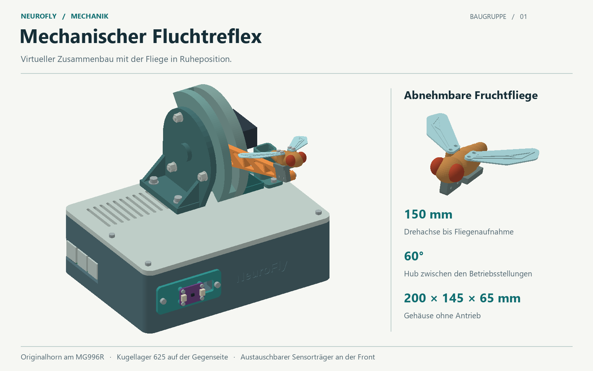
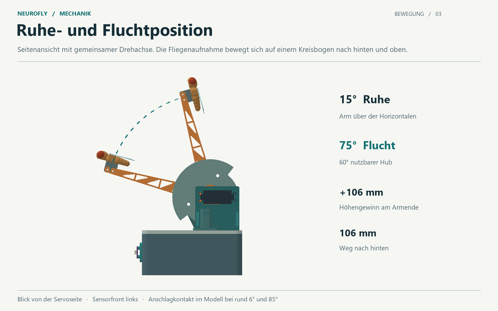

# NeuroFly · Mechanischer Fluchtreflex

Die [Bauanleitung als PDF](NeuroFly_Bauanleitung.pdf) enthält bebilderte Montageschritte. Für Bambu Studio liegt die [Schraubenplatte für X2D und AMS](NeuroFly_X2D_AMS_39_Schrauben_v2.3mf) sowie eine [STL mit allen 39 Schrauben](NeuroFly_Schraubenplatte_39_STL.stl) bei. Die 3MF wurde per Kommandozeile geslict, der Import in der grafischen Oberfläche und die gedruckten Gewinde wurden noch nicht geprüft. Die gedruckten Schrauben dienen zur Passprobe. Für belastete Verbindungen Metallschrauben verwenden und für das Servohorn die mitgelieferte Zentralschraube einsetzen. Ein separater Kopf 07 entfällt, da er in 06 integriert ist.

Der MG996R bewegt eine fest verschraubte Fruchtfliege auf einem 150-mm-Arm von 15° auf 75°. Der Sensor bleibt vorn links, die Bewegung findet rechts davon statt. Der Pi sitzt im 200 × 145 × 65 mm großen Gehäuse. Für den Tischaufbau rund 80 mm vor der Basis und 300 mm Höhe ab Tischfläche freihalten. Der Antrieb samt Gegenlager lässt sich auf dem abgenommenen Deckel montieren.



**Zuerst die vier Passproben drucken.** Die STL-Dateien sind exportiert und digital geprüft. Für das bestellte Servo fehlen chargenbezogene Maße des Horns und seiner Einbauhöhe. Die mechanische Freigabe erfolgt am gelieferten Exemplar. Druck, Passung, Lastlauf und Abschaltverhalten wurden nicht am realen Gerät erprobt.

## 1 · Was gedruckt wird

Alle STL-Dateien in Millimetern bei 100 % importieren, auf dem Druckbett zentrieren und auf die Platte setzen. Die Drucklage ist in der Datei enthalten. Jedes der folgenden Teile wird einmal gebraucht.

| Nr. | Teil | Funktion und Druckhinweis |
|---|---|---|
| 01 | Unterwanne | Pi-Dome, Kabelbinderösen, Bodenöffnung für microSD und drei Befestigungsbohrungen. Boden nach unten. An der Oberkante der langen Buchsenfenster bei Bedarf ablösbaren Support setzen. |
| 02 | Deckel | Sichtfläche auf das Bett, Versteifungsrippen nach oben. Fünf von außen zugängliche Schrauben. |
| 03 | Servobock MG996R | Montagefläche für die Original-Laschen liegt auf dem Bett. Durchbrüche und Kabelnut säubern. |
| 04 | Schwenkarm | Flach liegend drucken. Die Außenstege laufen vom Wurzelkreis bis zur Spitze in der Schichtebene. |
| 05 | Hornadapter | Zwei Langlöcher für das Original-Doppelhorn. Sechskanttaschen zum Bett, Taschen gegebenenfalls mit kleinem lokalem Support drucken. Passprobe 22 kann Teil 05 ersetzen. |
| 06 | Fliegenkörper mit Kopf | Bauchfläche auf das Bett. Kopf, Augen und gegliederter Hinterleib sind integriert. Die großen Augen lassen sich nach dem Druck farbig absetzen. |
| 08 / 09 | Linker / rechter Flügel | Je einmal flach drucken, Adern nach oben. Membran 0,8 mm. Transparentes PETG ist möglich. |
| 10 | Fliegensattel | Seitlich stehend exportiert. Zwei Schrauben erlauben den Wechsel des gesamten Insekts. |
| 11 | Sensorträger | Rückseite auf das Bett. Vier kleine Dome und seitliche Kabelöffnung. |
| 12 | Lagerschild | Innenseite zum Bett. Der Sitz nimmt ein 625-Lager auf. Die Kappe schützt das äußere Stiftende. |
| 13 | Stiftnabe | Flansch nach unten. Separat abnehmbar für Zugang zur zentralen Hornschraube. |
| 14 / 15 | Hintere Schutzscheibe / Schutzring | Die geschlossenen Flächen auf dem Bett lassen. Beide bilden mit dem Lagerschild den Schutz um die Armwurzel. |
| 16 | Servokabel-Führung | Fuß auf das Bett. Zwei Ösen halten den Kabelbinder. |

**Druckprofil für den ersten Satz.** 0,4-mm-Düse, 0,2-mm-Schichten und PETG. Für 03, 04, 05, 10, 12 und 13 mit mindestens vier Außenlinien und etwa 35–45 % Füllung beginnen. Für Wanne und Deckel vier Außenlinien, vier bis fünf Deck- und Bodenschichten sowie 15–25 % Füllung. Für die Fliege genügen drei Außenlinien und 10–15 % Füllung. Die Flügelmembran ergibt vier Schichten. Bei 06 Support nur lokal unter Augen oder Kopf setzen, falls die Vorschau des Slicers dort freie Linien zeigt. Keine Stützen in Gewinde-Kernlöcher oder in den Lagersitz setzen. Eine gefüllte erste Schicht oder ein breiter Rand kann die kleinen Öffnungen verengen. Jedes Einzelteil passt bei diesen Maßen auf 220 × 220 mm.

## 2 · Herstellermaße und Passproben

| Schnittstelle | Grundlage | Umsetzung |
|---|---|---|
| Raspberry Pi 3 Model B+ | 85 × 56 mm, Eckradius 3 mm, Bohrbild 58 × 49 mm, erster Lochmittelpunkt 3,5 mm von beiden Bezugskanten. Anschlusslagen aus der offiziellen Zeichnung. | Vier M2,5-Dome, Auflage 15 mm über der äußeren Bodenfläche. Breite Fenster lassen Platz für Steckergehäuse. [Mechanische Zeichnung von Raspberry Pi](https://datasheets.raspberrypi.com/rpi3/raspberry-pi-3-b-plus-mechanical-drawing.pdf) |
| Waveshare MG996R, SKU 15299 | 40,7 × 19,7 × 42,9 mm, 55 g. Das Herstellerfoto zeigt die offenen Laschen, das Doppelhorn und den Kabelausgang. Ein bemaßtes Horn- und Laschenlochbild für diese SKU ließ sich aus diesen Unterlagen nicht bestätigen. | Schlitzaufnahme, umlaufendes Körperspiel 0,30 mm je Seite, getrennte Gegenlagerstütze. [Produktdaten](https://www.waveshare.com/product/robotics/motors-servos/servos/mg996r-servo.htm) · [Herstellerfoto mit Originalhörnern](https://www.waveshare.net/photo/accessories/MG996R-Servo/MG996R-Servo-1.jpg) |
| Adafruit VL53L4CD Nr. 5396 | Verkaufsmaß 25,5 × 17,7 × 4,6 mm. Eagle-Kontur 25,40 × 17,78 mm, vier Bohrungen Ø 2,50 mm, Lochabstand 20,32 × 12,70 mm. Die optische Baugruppe U1 liegt in der Mitte. | M2-Schrauben auf vier Domen. Offene Vorderseite. Zwei äußere Schrauben halten die wechselbare Platte. [Produktdaten und 18° diagonales Sichtfeld](https://www.adafruit.com/product/5396) · [Geprüfte Adafruit-Platinendatei](https://github.com/adafruit/Adafruit-VL53L4CD-PCB/blob/de475b8aede92ff30e66671ded9ec015fc0df6ba/Adafruit%20VL53L4CD.brd) |

**21 · Laschenlehre.** Den hinteren Servokörper mit Kabel durch die Öffnung führen, bis beide Laschen flach anliegen. Der Kabelausgang darf kein Gewicht tragen. Alle vier M3-Schrauben mit Unterlegscheiben einsetzen. Am realen Servo Körperbreite und -tiefe, Lochmittenabstand längs und quer sowie den Abstand der Achse vom nahen Gehäuseende messen. CAD-Startwerte sind `servo_mount_spacing=[49.5,10]` und `servo_axis_from_end=10` mm. Die Lehre bildet die Aussparung und Schraubenpositionen ab, ihre Dicke beträgt 3 mm, die tragende Platte ist 5 mm dick.

**22 · Hornlehre.** Das originale Doppelhorn aufsetzen und mit seiner zugehörigen Zentralschraube sichern. Die beiden Langlöcher decken im Standardmodell je 10–14 mm Radius ab. Zwei gegenüberliegende Hornlöcher mit M2-Schrauben und Muttern prüfen. Falls die Bohrungen kleiner sind, den möglichen Durchmesser und die verbleibende Hornwand prüfen. Bei ungeeigneten M2-Löchern die Schnittstelle auf passende Schrauben umarbeiten und die Lehre neu drucken. Beide Schrauben müssen tragen. Die Wellenverzahnung entsteht ausschließlich durch das Originalhorn.

Mit Tiefenmaß oder Messschieber **von der Auflageunterseite der Laschen bis zur äußeren ebenen Anlagefläche des montierten Horns** messen. Der Startwert für `flange_to_horn_face` ist 15 mm, für `ear_t` 2,5 mm und für `horn_t` 2,2 mm. Beim Einsatz der Gummitüllen und Messinghülsen zählt die neue tatsächliche Auflage. Die Standardkonstruktion sieht direkte Laschenauflage und breite Scheiben vor. Bei geänderter Aufbauhöhe Bock und Deckel gemeinsam neu exportieren. Hornnabe, Originalschraube, überstehende Hornenden und rückseitige M2-Muttern beim Durchschwenken auf Freigang prüfen.

**23 · Lagerlehre.** Das 625 muss bis zur Schulter in die Ø-16,12-mm-Aufnahme passen. Nur den Außenring belasten. Es soll mit leichtem Handdruck sitzen und darf nicht kippen. Zu eng oder zu lose: `bearing_seat_extra` in 0,05-mm-Schritten an den eigenen Drucker anpassen. Der glatte Ø-5-Stift muss ohne Gewalt in den Innenring gleiten. Im Betrieb dreht der Innenring mit.

**24 · Schraubenlehre.** In der Reihe vom kleinsten Loch aus M2, M2,5, M3, den 5-mm-Nabenstift und die M3-Mutter prüfen. Für PETG die Gewinde zuerst am Muster von Hand mit gerader Schraube vorformen oder mit passendem Gewindebohrer schneiden. Bei Rissen, durchdrehendem Gewinde oder festsitzendem Stift die Kernlochparameter anpassen. `pin_socket=5.12` mm dient als Ausgangswert für den geklebten Stift in Teil 13.

## 3 · Kaufteile und Schrauben

Die Schraubenlängen gelten ab Kopfunterseite für den gezeigten Aufbau. Linsenköpfe bzw. flache Zylinderköpfe verwenden. Bei einer geänderten Hardwarecharge zuerst die reale Paketdicke prüfen. Für stehende Verbindungen genügen übliche Stahlschrauben. Die Original-Hornschraube verbleibt am Servo.

| Verbindung | Stückzahl und Größe | Zubehör |
|---|---|---|
| Pi auf 01 | 4 × M2,5 × 8 | Kleine Köpfe, bei Bedarf dünne isolierende Scheiben |
| Deckel auf 01 | 5 × M3 × 14 | Kernlöcher in den fünf hochgezogenen Domen |
| Füße von 03 und 12 auf 02 | 4 × M4 × 20 | 8 flache M4-Scheiben, 4 selbstsichernde M4-Muttern |
| MG996R-Laschen auf 03 | 4 × M3 × 12 | 4 breite M3-Scheiben außen, Ø 8 mm, 4 normale Scheiben und 4 M3-Muttern auf der Rückseite |
| Original-Doppelhorn auf 05 | 2 × M2 × 10 | 2 M2-Scheiben, außen max. Ø 5 mm, je 1 flache M2-Mutter hinter dem Horn |
| Originalhorn auf Servo | 1 originale Zentralschraube | Länge und Gewinde des gelieferten Servos verwenden |
| 13 und 04 auf 05 | 2 × M3 × 14 | 2 normale M3-Sechskantmuttern, SW 5,5, in den Adaptertaschen |
| 14, 15 und 12 verbinden | 3 × M4 × 40 | 6 M4-Scheiben und 3 selbstsichernde M4-Muttern. Zwei Bolzen erhalten weiche Hülsen. |
| Gegenlager | 1 × 625-2RS oder 625-ZZ, 5 × 16 × 5 mm | 1 glatter Stahlstift Ø 5 × 16 mm, gleitend im Innenring, z. B. Toleranz h6. Wenig 2K-Epoxidkleber für Stift und Nabe. |
| Puffer | 2 × Silikonschlauch, Ø 4 mm innen, Ø 8 mm außen, Länge je 8 mm | Weich und elastisch, z. B. etwa 50 Shore A als Startwert |
| 10 auf 04 | 2 × M2,5 × 10 | Durch den Arm in die Gewinde des Sattels |
| 06 auf 10 | 1 × M3 × 10 | Von der Unterseite des losen Sattels einschrauben |
| Flügel auf 06 | 4 × M2 × 6 | Zwei Schrauben pro Flügel |
| Adafruit-Platine auf 11 | 4 × M2 × 5 | Köpfe max. ca. Ø 3,8 mm, ohne Berührung der Nachbarbauteile |
| Sensorträger auf 01 | 2 × M3 × 10 | Von vorn in die Wanddome |
| Kabelkanal 16 auf 02 | 2 × M3 × 8 | Von oben ins Deckelgewinde |
| Tischbefestigung | 4 rutschhemmende Füße oder 3 × M4 mit Scheiben und Muttern | Beispiel für eine 15-mm-Vorführplatte bei flacher Auflage: M4 × 30. Länge bei anderen Platten bzw. Distanzstücken anpassen. |

Dazu kommen Pi 3B+, microSD, dessen eigenes Micro-USB-Netzteil, Waveshare MG996R mit Zubehör, der Sensor mit STEMMA-QT-/I²C-Kabel, eine kleine isolierte Verbindungsklemme mit Befestigung, ein externes geregeltes Servo-Netzteil, eine passende Leitung, Kabelbinder bis 2,5 mm Breite und eine zur Leitung passende Gummitülle für die Ø-13-mm-Rückwandöffnung und 2,8-mm-Wand. Durchgangskanten am Deckel entgraten und mit dünnem Kantenschutz versehen. Ein kleiner Innensechskant-/Schraubendrehersatz, Mutternschlüssel, Seitenschneider und Messschieber reichen für die normale Montage. Die Lehren entscheiden, ob die gedruckten Kernlöcher eine Nacharbeit benötigen.

## 4 · Montage


1. **Wanne und Pi.** Bei Montage auf einer Vorführplatte zuerst die Bodenbefestigung erledigen. Der Pi sitzt hinten links. USB und Ethernet zeigen nach links, Micro-USB und HDMI nach hinten. Die Platine zunächst wenige Millimeter zur Gehäusemitte versetzt absenken. Auf Höhe der Fenster beide Anschlussseiten in die Öffnungen schieben und den Pi auf die vier Dome legen. M2,5 × 8 nur anlegen. Die Karte ist bei abgezogener Versorgung durch den Griffausschnitt im Boden erreichbar. Bei fester Montage den passenden Ausschnitt in der Vorführplatte freilassen oder die Wanne zum Kartenwechsel lösen. Den GPIO-Kabelbaum bei offenem Deckel stecken. Die Antennenecke und den Raum direkt darüber von Metall und Kabelbündeln freihalten.
2. **Sensor und Versorgung.** Die Sensorplatine mit der Optik nach vorn auf 11 setzen, mit vier M2 × 5 befestigen und den seitlichen JST-Stecker einsetzen. Leitung durch die versetzten Öffnungen nach innen führen. Etwas Serviceschlaufe lassen und 11 von außen verschrauben. Zum Wechsel reichen die zwei Frontschrauben. Versorgung des Servos über die Tülle hinten rechts einführen, den Mantel an der inneren Öse mit Kabelbinder entlasten. Für eine kleine Klemme ist vorn rechts z. B. der Bereich X = 115–155, Y = 20–55 mm frei. Klemme isoliert fixieren. Koordinaten beginnen vorne links.
3. **Feststehenden Antrieb aufbauen.** Auf dem abgenommenen Deckel zuerst 03 mit zwei M4 × 20 befestigen. Muttern sitzen unten. Den Servo mit dem Kabel voran durch die Montageöffnung führen. Beide Laschen plan, vier breite Scheiben auf den offenen Laschen, jeweils eine M3 × 12 und eine Mutter einsetzen. Die Abtriebswelle weist quer zur Armbewegung zum Lagerschild. 16 neben dem Motorgehäuse über der Deckelöffnung befestigen.
4. **Servo vorpositionieren.** Den unbelasteten Servo ohne Arm ansteuern. Die elektrische Mittelstellung und die tatsächliche Bewegungsrichtung feststellen. Für die Mitte des mechanischen Hubs 45° Armwinkel vorsehen. Strom aus. Die hintere Schutzscheibe 14 über die Nase führen und lose in Position halten. Das ausgewählte Originalhorn zunächst probeweise indexieren, bis die Armstellung passt. Nur kleine Restabweichungen später per Software ausgleichen.
5. **Horn und Arm koppeln.** Die M3-Muttern in 05 einlegen. Das Doppelhorn an der Rückseite des Adapters ausrichten, zwei M2 × 10 von der Armseite durch die Langlöcher stecken und hinten am Horn mit Muttern sichern. Originalhorn auf die Welle setzen und die originale Zentralschraube durch das Mittelloch von 05 anziehen. Die Schraubenköpfe der M2-Verbindung liegen in den rückseitigen Taschen von 04. Vor dem Aufsetzen prüfen, dass sie bündig in diese Freistellungen passen.
6. **Gegenlager ausrichten.** Den Ø-5-Stift 7 mm tief in 13 einkleben, 9 mm stehen über. Kleber aushärten lassen. Arm und Nabe mit zwei M3 × 14 auf 05 setzen. Das 625 mit dem Außenring bis zur Schulter in 12 drücken. Teil 15 mit seiner ausgesparten Seite zur Bewegungsbahn aufsetzen. Den Lagerschild samt Lager von außen axial auf den Stift schieben. Normal sind etwa 1 mm axialer Abstand zwischen Nabenstirn und Innenring und ein freies Stiftende unter der Kappe. Mit zunächst losen Fußschrauben ausrichten. Das Lager muss ohne seitliches Ziehen oder Biegen aufgleiten. Versatz längs der Welle über die Deckelschlitze ausgleichen, Höhenversatz über vollflächige dünne Unterlagen unter einem Fuß oder korrigierte CAD-Maße. Beide Schrauben des Lagerschildfußes anziehen. Bei fühlbarer Verspannung zurück zur Maßprüfung.
7. **Anschläge und Schutz schließen.** Die beiden 8-mm-Silikonhülsen in den laufenden Armschlitz an den beiden Enden der Bewegung legen. Je eine M4 × 40 mit Scheibe von der hinteren Schutzscheibe durch Hülse und Lagerschild führen. Der dritte Bolzen geht durch den geschlossenen Steg gegenüber der Bewegungsöffnung. Außen Scheiben und selbstsichernde Muttern montieren. Ring und Deckflächen müssen an den starren Abstandflächen anliegen, die Hülsen müssen ihre runde Form behalten. Prüfen, dass die Armkante zuerst das Silikon trifft. Der seitliche Spalt im Standardmodell beträgt pro Armseite 1 mm.
8. **Fliege befestigen.** Teil 06 auf den Positionierstift von 10 setzen. Vor dem Anbau an den Arm die M3 × 10 von der Sattelunterseite in den Bauch schrauben. 08 und 09 mit je zwei M2 × 6 auf die ebenen Schulterflächen setzen, Adern nach oben. Sattel seitlich mit zwei M2,5 × 10 durch die Armspitze verschrauben. Diese beiden Schrauben lösen die komplette Fliege. Leichte Schraubensicherung nur verwenden, wenn sie für die beteiligten Kunststoffe ausdrücklich geeignet ist.
9. **Kabel und Deckel.** Das Servokabel direkt vom ruhenden Motorgehäuse zur Führung 16 führen, unterhalb der Achse fixieren und durch den Deckel leiten. Die innere Leitung zwischen den Führungsrippen und an den Bodenösen sichern. Oberhalb der Welle bleibt die Bahn frei. Zum Abnehmen des Deckels eine von oben erreichbare Steckverbindung bzw. Serviceschlaufe lassen. Vor dem Schließen Zugentlastung, Biegeradien, Stecker und die fünf Schraubenwege prüfen. Deckel mit fünf M3 × 14 schließen.

## 5 · Versorgung und Inbetriebnahme

Der Pi erhält seine eigene Versorgung am Micro-USB-Anschluss. Der MG996R erhält seine externe geregelte 5–6-V-Versorgung. Die Plusleitungen bleiben getrennt. Pi-GND, Servo-GND und Minus des Servo-Netzteils an der Klemme verbinden. PWM vom vorgesehenen GPIO zum Signalanschluss führen. Laut Herstellerfoto sind beim gezeigten Exemplar Orange = PWM, Rot = Versorgung und Braun = GND. Die Beschriftung am gelieferten Servo prüfen. Für das Adafruit-Board VIN auf 3,3 V, GND, SDA und SCL am Pi verwenden. Das Servo-Netzteil samt Leitung muss auch den Anlaufstrom liefern. Waveshare gibt auf der verlinkten Produktseite keinen verlässlichen Blockierstrom für die Auslegung an. Spannungseinbruch unter realer Bewegung messen. Nur externe Niederspannung in die Wanne führen. [Waveshare-Anschlussbelegung](https://www.waveshare.net/photo/accessories/MG996R-Servo/MG996R-Servo-5.jpg) · [Adafruit-Anschlussanleitung](https://learn.adafruit.com/adafruit-vl53l4cd-time-of-flight-distance-sensor/python-circuitpython)



- **Mechanik getrennt prüfen.** Vor dem Verzahnen bzw. bei gelöstem Horn den Arm mit montierten Schutzteilen langsam durch beide Endlagen führen. Zahnradgetriebe nicht gewaltsam von Hand drehen. Dreht der Arm frei, ohne dass die Nabe am Außenring oder der Arm am Schutzring schleift? Erreichen die weichen Anschläge beide Armkanten vor allen harten Strukturen? Schrauben und Scheiben markieren und nach den ersten Zyklen auf Verdrehen prüfen.
- **Softwarewinkel kalibrieren.** 15° und 75° sind reale Armwinkel gegen die Horizontale. Die passenden elektrischen Stellwerte separat ermitteln. Zuerst ohne Fliege und mit niedriger Geschwindigkeit von der Mitte um wenige Grad verfahren. Enden schrittweise annähern. Den gesamten zulässigen PWM-Bereich so begrenzen, dass beide Puffer selbst bei Nachlauf frei bleiben. Eine zusätzliche Begrenzung muss auch bei Neustart oder einem fehlerhaften NeuroHex-Signal wirksam bleiben.
- **Reflex auslösen.** Eine Gefahrenschwelle in NeuroHex startet genau einen Hub. Während Hub und Rückfahrt weitere Trigger sperren. Als erste Lastfahrt 60° in mindestens 0,45 s, Rückfahrt in etwa 1,2 s ansetzen. Für beide Richtungen eine glatte Positionsrampe verwenden, etwa `s(u)=10u³−15u⁴+6u⁵` für die normierte Zeit von 0 bis 1. Im Fehlerfall keine neue Fahrt starten. Vor dem Abschalten in Ruhe fahren. Nach Stromausfall kann der Arm durch Eigengewicht bis zum unteren Puffer absinken. Das stromlose Verhalten bei niedriger Ausgangshöhe zuerst beaufsichtigt prüfen.
- **Sensor und Nutzerbereich testen.** Mit ruhender Hand, leerem Tisch und einem vollständigen Armhub prüfen, dass weder Fliege noch Kabel auslösen. Die Hand ausschließlich vor dem Sensor führen. Die Optik ist offen und der Armschlitz durch die Schutzscheiben abgeschirmt. Den Aufbau für die Vorführung so platzieren, dass niemand seitlich in den Schwenkbereich greifen kann. Auch Untergrundreflexionen und Hell-Dunkel-Wechsel in der späteren Umgebung prüfen.
- **Stand, Geräusch und Temperatur.** Auf ebener Unterlage langsam beginnen, dann mehrere vollständige Zyklen. Bei wandernder Basis, Brummen in Endlage, elastischem Verziehen des Deckels, heißem Servo oder fallender Versorgung die Bewegung beenden. Für den Schulbetrieb lässt sich die Wanne mit den drei Ø-4,5-mm-Bodenlöchern auf einer Vorführplatte befestigen. Ein blockierter Servo ist ein eigener Lastfall und gehört nicht zum normalen Hub.

## 6 · CAD ändern und erneut exportieren

`CAD/NeuroFly.scad` enthält die Originalgeometrie, die Montagepositionen und die vereinfachten Kaufteile. In OpenSCAD öffnen. `part=0` zeigt die Baugruppe, `pose=75` die Fluchtstellung. `part=4` zeigt den druckorientierten Arm. Für den Einzel-STL-Export F6 rendern und als STL exportieren. Die Tabelle in `CAD/export.py` ordnet jede Nummer ihrem Dateinamen zu.

Die wichtigsten Parameter stehen oben in der SCAD-Datei. `arm_length` unterstützt 100–180 mm. `arm_escape_angle` ist der absolute Zielwinkel. `pose=arm_escape_angle` zeigt diesen direkt an. `wall_thickness`, `screw_clearance` und `print_tolerance` sind getrennt einstellbar. Bei einer anderen Sensorplatine zunächst nur 11 ändern, die äußeren M3-Löcher bei ±29 mm und die feste seitliche Kabelöffnung beibehalten. Änderungen von Arm, Horn, Fußposition, Gehäusegröße oder Puffern erfordern eine neue Prüfung des **gesamten** Hubs, der Schraubwege und des Kippmoments. Die angegebenen Prüfergebnisse gelten für die gelieferten STL-Dateien.

Beispiele vom Projektordner aus, mit OpenSCAD 2021.01 oder neuer. Für den Sammelexport genügt Python 3.9+ ohne zusätzliche Python-Pakete.

```powershell
python CAD/export.py --openscad "C:/Program Files/OpenSCAD/openscad.exe"
python CAD/export.py --openscad "C:/Program Files/OpenSCAD/openscad.exe" --part 21
```

```sh
openscad --export-format binstl -D part=4 -o STL/04_swing_arm.stl CAD/NeuroFly.scad
```

[Prüfbericht mit Meshmaßen, Drehmomentabschätzung und Grenzen der virtuellen Prüfung](PRUEFBERICHT.md)
